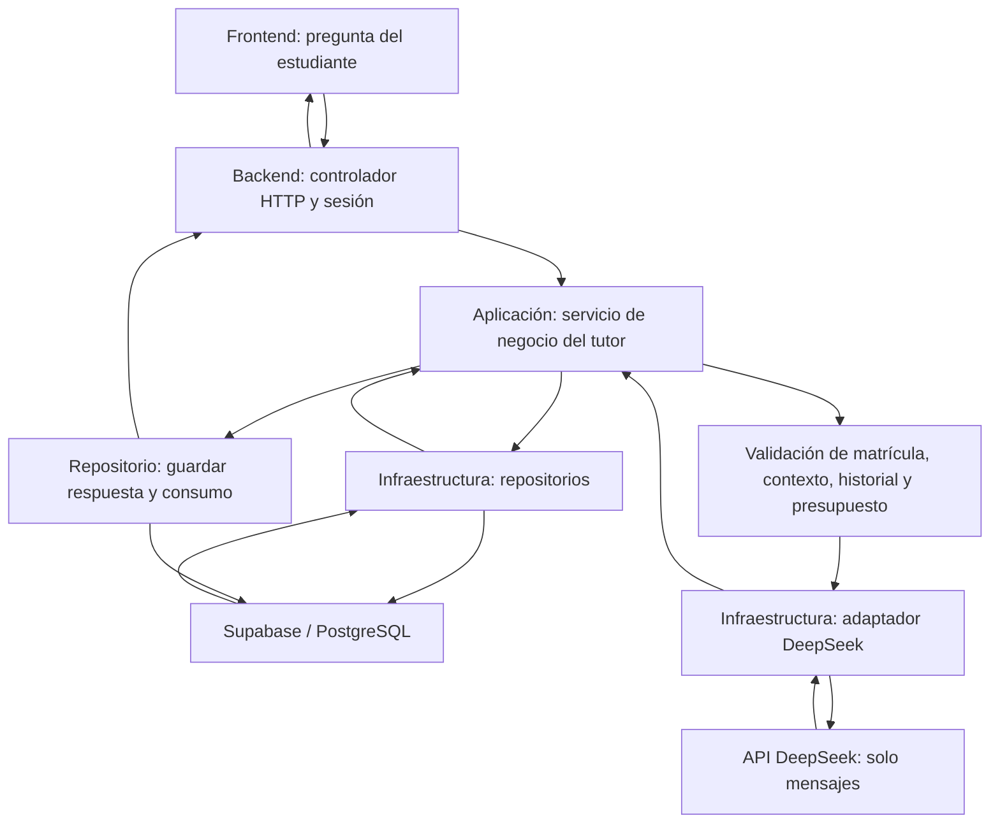

# AulaIA

AulaIA es una plataforma web de aprendizaje virtual para gestionar cursos, lecciones, evaluaciones y progreso académico. Incorpora un Tutor IA contextual dentro de cada lección, con conversaciones persistentes, valoración de respuestas y control de consumo. El repositorio incluye acceso, perfiles, catálogo, gestión de contenido, matrículas, progreso, evaluaciones y resultados.

Primera entrega disponible en [AulaIA](https://aulaia-ivory.vercel.app). El acceso a los cursos requiere iniciar sesión.

## Estado actual

Se pueden recorrer las siguientes vistas:

| Ruta | Vista | Disponible ahora |
|---|---|---|
| `/login` | Acceso | Inicio de sesión con Supabase Auth |
| `/registro` | Registro | Alta de estudiantes por correo y contraseña |
| `/inicio` | Inicio del estudiante | Matrículas, progreso, siguiente lección pendiente y recomendaciones desde Supabase |
| `/catalogo` | Catálogo | Cursos publicados y categorías desde Supabase, con búsqueda y filtros |
| `/admin/tutor` | Seguimiento del asistente | Consultas, fallos, latencia media, tokens, costo estimado y valoraciones; acceso administrativo |
| `/cursos/[curso]` | Detalle de curso | Contenido publicado, matrícula y resumen del avance propio |
| `/cursos/[curso]/lecciones/[leccion]` | Lección | Contenido persistente, marcar o desmarcar como completada y Tutor IA al configurar DeepSeek |
| `/admin` | Panel de administración | Accesos a contenido, evaluaciones y métricas del tutor con rol `admin` |
| `/admin/cursos` | Gestión de contenido | Crear, editar y publicar cursos; administrar módulos y lecciones con rol `admin` |
| `/admin/evaluaciones` | Gestión de evaluaciones | Crear borradores, administrar preguntas y publicar con rol `admin` |
| `/cursos/[curso]/evaluaciones/[evaluacion]` | Evaluación | Responder preguntas de opción múltiple y consultar intentos propios |
| `/cursos/[curso]/evaluaciones/[evaluacion]/resultados/[intento]` | Resultado | Nota y revisión de respuestas del intento propio |
| `/resultados` | Mis resultados | Historial personal, incluso de evaluaciones despublicadas |

La ruta `/` abre `/inicio`. Con Supabase configurado, las rutas de estudiante y lección requieren una sesión verificada. Las cuentas nuevas reciben el rol `student`. El catálogo y el contenido publicado se leen desde Supabase. Cada cuenta puede matricularse, completar lecciones y retomar la primera pendiente; los datos se conservan entre sesiones. La gestión de contenido exige rol `admin` tanto en las acciones del servidor como en PostgreSQL. El Tutor IA consulta DeepSeek desde el servidor con el contenido de la lección.

El porcentaje de avance se calcula con las lecciones actuales del curso, sin almacenar un porcentaje editable por el navegador. Las claves compuestas impiden duplicar matrículas y completados. Las políticas RLS restringen el avance a su propietario y exigen una matrícula para completar lecciones. Si se elimina una lección, se elimina su completado asociado; si se agrega contenido, el avance se recalcula. Las actividades del inicio son lecciones pendientes reales.

Las evaluaciones se habilitan cuando el estudiante está matriculado y ha completado todas las lecciones actuales de un curso con contenido. PostgreSQL aplica esa condición al leer preguntas y al enviar un intento. Admite hasta 50 preguntas de cuatro alternativas y calcula `aciertos × 20 / preguntas`, con dos decimales y un mínimo aprobatorio configurable entre 1 y 20. Las claves correctas se guardan en un esquema privado. Cada envío conserva las preguntas respondidas y el criterio de aprobación, e incluye un identificador para evitar duplicados y una versión para rechazar formularios antiguos. Solo se editan borradores sin intentos. El menú “Mis resultados” conserva los intentos anteriores aunque se añadan lecciones o se despublique una evaluación.

Sin credenciales, `pnpm dev` permite recorrer las vistas de ejemplo localmente. En producción, las rutas de estudio no se abren sin Supabase configurado.

### Contenido de la primera entrega

Los seis cursos publicados incluyen dos módulos y cuatro lecciones cada uno, con explicaciones, ejemplos y actividades de práctica. Las siete evaluaciones reúnen 21 preguntas. El curso de Python conserva su primera evaluación y añade otra de decisiones y funciones. La duración indicada es de dos horas por curso introductorio, incluyendo práctica.

La migración `20261027010000_initial_learning_content.sql` carga este contenido sin reemplazar lecciones, preguntas ni intentos existentes. Puede repetirse sin duplicar registros. La administración permite ampliar y editar el contenido desde la aplicación; las evaluaciones con intentos conservan sus restricciones de edición.

El acceso acepta un correo o los usuarios de demostración `alumno1`, `alumno2` y `profesor1`. Se autentican con Supabase y su contraseña; el nombre corto no evita ninguna comprobación de sesión. Las cuentas y sus credenciales se configuran fuera de Git. `profesor1` tiene gestión de contenido; los alumnos solo acceden a sus propias matrículas, progreso y resultados. Los datos de esas cuentas representan escenarios de prueba.

El tutor exige sesión, matrícula y una lección publicada. Obtiene el contexto desde Supabase y añade el avance del estudiante y hasta tres intercambios anteriores de la misma conversación. El navegador no puede enviar mensajes de sistema ni historiales fabricados. Las respuestas se guardan antes de confirmarlas y se recuperan al abrir de nuevo la lección. Cada respuesta admite una valoración útil o un reporte con comentario. El contenido Markdown se presenta sin HTML, enlaces ni imágenes externas generadas por el modelo.

En las lecciones, el tutor se abre desde un botón circular flotante. El panel se puede minimizar o cerrar con Escape sin perder el borrador, la conversación ni una respuesta en curso. Una invitación discreta ofrece ayuda después de un tiempo de lectura, con un intervalo mínimo de 20 minutos entre avisos en la misma pestaña. Abrir el panel y mostrar el aviso no realiza consultas al proveedor de IA.

## Tecnologías

| Área | Tecnología |
|---|---|
| Aplicación web | Next.js 16 y React 19 |
| Lenguaje | TypeScript |
| Estilos | Tailwind CSS 4 y CSS global |
| Iconos | Lucide React |
| Autenticación y perfiles | Supabase Auth y PostgreSQL con RLS |
| Tutor IA | DeepSeek API, modelo `deepseek-flash` por defecto |
| Despliegue | Vercel |
| Pruebas | Vitest y Testing Library |
| Pruebas de base de datos | PGlite, con PostgreSQL y simulación de los roles de Supabase |
| Gestor de paquetes | pnpm |

## Organización frontend y backend

El repositorio separa la interfaz y el servidor en dos carpetas de un workspace pnpm. Conserva la arquitectura por capas dentro del backend y un único despliegue de Next.js. El backend es un paquete de servidor utilizado por las rutas y Server Actions; no requiere un segundo servicio ni un puerto adicional.

```text
AulaIA/
├── frontend/
│   ├── src/
│   │   ├── app/                    Páginas, layouts y entradas de rutas Next.js
│   │   ├── presentation/           Vistas, componentes React y estilos
│   │   └── proxy.ts                Entrada de renovación de sesión
│   ├── public/                     Imágenes e identidad visual
│   ├── next.config.ts
│   └── package.json
├── backend/
│   ├── src/
│   │   ├── interfaces/
│   │   │   ├── http/               Controladores HTTP del tutor y autenticación
│   │   │   ├── actions/            Acciones de sesión, contenido y aprendizaje
│   │   │   └── composition/        Conexión de servicios con sus adaptadores
│   │   ├── application/            Casos de uso y lógica de negocio
│   │   ├── domain/                 Entidades y contratos
│   │   └── infrastructure/
│   │       ├── supabase/           Repositorios y clientes de servidor
│   │       ├── deepseek/           Adaptador HTTP del proveedor IA
│   │       └── demo/               Datos de ejemplo para desarrollo
│   ├── supabase/
│   │   ├── migrations/             Esquema, contenido inicial y políticas RLS
│   │   └── tests/                  Pruebas SQL
│   ├── scripts/                    Verificación y evaluación optativa
│   ├── prolog/                     Representación lógica académica
│   └── package.json
├── tests/                          Pruebas unitarias, de integración y arquitectura
├── .env.example                    Plantilla de variables del proyecto
├── package.json                    Comandos y herramientas comunes
└── pnpm-workspace.yaml
```

### Flujo del Tutor IA



`createTutorService` verifica que el curso y la lección estén publicados, comprueba la matrícula y prepara el contexto y el historial autorizado. La reserva de consumo se confirma antes de llamar al proveedor. La respuesta se guarda antes de devolverla al navegador; un fallo al guardar no dispara otra consulta pagada. La lectura del historial también pasa por el servicio y requiere matrícula.

DeepSeek recibe únicamente el mensaje de sistema preparado, la pregunta y el historial acotado. No recibe clientes de Supabase, credenciales de base de datos, herramientas SQL ni permisos para consultar o modificar registros. Los repositorios de Supabase y el adaptador DeepSeek son independientes; el servicio de aplicación coordina ambos mediante contratos.

### Reglas de dependencia

- El dominio y la aplicación no importan Next.js, React ni adaptadores de infraestructura.
- Los componentes de navegador muestran datos y llaman a `/api/tutor` o a Server Actions.
- Los componentes de servidor de Next.js pueden cargar datos mediante el backend antes de renderizar una página.
- Las rutas `frontend/src/app/api/tutor/route.ts` y `auth/callback/route.ts` son entradas mínimas que delegan a controladores del backend.
- Las acciones de formularios se implementan en `backend/src/interfaces/actions/`, con `use server`.
- La composición conecta puertos del negocio con repositorios y proveedor; los adaptadores no se llaman entre sí.
- Los módulos que acceden a claves del tutor llevan `server-only`, para impedir su inclusión en componentes de navegador.
- Las pruebas de arquitectura verifican el sentido de las dependencias y el aislamiento de los componentes cliente.

## Ejecución local

Requiere Node.js compatible con Next.js 16 y pnpm 11.

```bash
git clone https://github.com/Jefferson1225/AulaIA.git
cd AulaIA
pnpm install
pnpm dev
```

Abre `http://localhost:3000`. Ejecuta los comandos desde la raíz de AulaIA; `pnpm dev`, `pnpm build` y `pnpm start` delegan en el paquete `frontend`. El archivo privado `.env.local` permanece en la raíz y la configuración del servidor lo carga sin trasladar ni publicar sus claves. Para activar el acceso real, crea `.env.local` a partir de `.env.example` y completa `NEXT_PUBLIC_SUPABASE_URL` y `NEXT_PUBLIC_SUPABASE_PUBLISHABLE_KEY`. Aplica las migraciones de `backend/supabase/migrations/` en orden y habilita el proveedor de correo en Authentication. Las migraciones son incrementales: en una base existente aplica solo las pendientes. `20261026000000_assessments.sql` requiere contenido y matrículas e incluye una evaluación de muestra en Python. `20261027000000_tutor_persistence.sql` incorpora historial, control de gasto y valoraciones. Configura las URL de redirección de localhost y del despliegue.

DeepSeek es opcional para probar matrículas, avance y evaluaciones. Para activar el tutor configura estas variables privadas:

| Variable | Uso |
|---|---|
| `DEEPSEEK_API_KEY` | Clave del proveedor, utilizada únicamente en el servidor |
| `DEEPSEEK_MODEL` | `deepseek-flash`; cambiar de modelo requiere revisar las tarifas y la reserva |
| `SUPABASE_SERVICE_ROLE_KEY` | Clave de servidor de Supabase; acepta la clave secreta actual del proyecto o la legacy `service_role` |
| `TUTOR_MAX_BUDGET_USD` | Tope acumulado del proyecto en USD; el ejemplo usa `0.02`; `0` desactiva consultas nuevas |

La clave de servidor y la de DeepSeek nunca deben llevar el prefijo `NEXT_PUBLIC_`. Reinicia el servidor tras modificar variables. Configura las mismas variables privadas y públicas en Vercel para cada entorno de despliegue.

Supabase puede pedir confirmación por correo al registrarse, según la configuración del proyecto. Las cuentas nuevas reciben rol `student`; para gestionar contenido hay que asignar `admin` a una cuenta desde el editor SQL de Supabase, después de verificar su UUID en Authentication. No se cambia el rol desde el formulario público. La política RLS permite leer el perfil propio y editar únicamente el nombre. El Tutor IA tiene un máximo de 30 preguntas por usuario y día UTC, aplicado en PostgreSQL para compartir el límite entre instancias.

La admisión del tutor reserva el costo antes de llamar al proveedor, serializa el cálculo de presupuesto entre instancias y bloquea consultas simultáneas del mismo usuario durante 60 segundos. Usa Flash sin razonamiento, respuestas de hasta 512 tokens y un tiempo máximo de 30 segundos para la llamada. No hay reintentos automáticos. Los fallos sin consumo confirmado conservan la reserva; una interrupción puede dejar una consulta pendiente y los fondos retenidos para revisión. Un registro privado sin datos del estudiante conserva los importes aunque se elimine una cuenta o lección. El tope no se reinicia cada día y es independiente del saldo de DeepSeek. La estimación usa las tarifas máximas verificadas el 26/10/2026 y debe revisarse si el proveedor las modifica.

## Verificación

```bash
pnpm lint
pnpm typecheck
pnpm test
pnpm test:db
pnpm build
```

Las pruebas cubren catálogo, avance, vistas, formularios, envío de evaluaciones, contexto e historial del tutor, consumo y errores del proveedor. `pnpm test:db` crea una base efímera, aplica todas las migraciones y ejecuta `backend/supabase/tests/`: aislamiento entre usuarios, permisos, calificación, versiones, presupuesto, cupo, conservación del consumo y valoraciones. No utiliza el proyecto remoto ni llama a DeepSeek.

`node backend/scripts/verify-supabase.mjs` permite verificar el proyecto remoto con dos cuentas sintéticas dedicadas. Requiere `AULAIA_TEST_ACCOUNTS` apuntando a un JSON local con dos objetos `{ "id", "email", "password" }`, y `AULAIA_LIVE_OUTPUT` como ruta de salida externa al repositorio. Solo admite correos con prefijo `aulaia-cap2-` y dominio `example.invalid`. Las cuentas deben crearse para pruebas y tener correo confirmado. El script matricula esas cuentas, registra avance e intentos y comprueba aislamiento; no envía correos ni consulta la IA.

### Evaluación optativa del asistente

Los 12 casos de `tests/evaluation/tutor-cases.json` cubren conceptos, ejemplos, continuidad, información insuficiente, preguntas ajenas al tema e instrucciones adversarias. `node backend/scripts/evaluate-tutor.mjs` muestra la preparación sin efectuar consultas. Para ejecutar llamadas reales, con Node.js 24, servidor local activo y una cuenta de prueba, configura `EVAL_EMAIL`, `EVAL_PASSWORD` y `EVAL_OUTPUT` (archivo externo al repositorio), y ejecuta:

```bash
node backend/scripts/evaluate-tutor.mjs --run
```

El script exige un tope configurado de hasta USD 0.02, registra respuestas y métricas, y se detiene ante el primer rechazo o fallo. Los casos no se califican automáticamente como correctos: sus criterios deben contrastarse con las respuestas. Una muestra pequeña de desarrollo no mide satisfacción de estudiantes ni mejora del aprendizaje. Las credenciales, respuestas de evaluación y capturas locales no se incorporan al repositorio.

## Siguientes etapas

1. Ampliar el contenido académico y validar el prototipo con estudiantes y docentes.
2. Refinar los prompts y revisar periódicamente respuestas, reportes y tarifas del proveedor.
3. Mantener la publicación en Vercel y verificar cada actualización antes de desplegarla.

Proyecto desarrollado con fines académicos. La estructura permite incorporar estas funciones de forma gradual.

## Publicación en Vercel

La primera entrega está publicada en `https://aulaia-ivory.vercel.app`. Se comprobaron el inicio de sesión de alumno y administrador, la gestión de cursos y métricas y una consulta del tutor con recuperación de su conversación después de recargar la página. Los registros de demostración permiten probar el recorrido; no representan una validación con estudiantes reales.

La configuración raíz `vercel.json` ejecuta la compilación del workspace y utiliza `frontend/.next` como directorio de salida. Mantén la raíz del repositorio como Root Directory en este flujo; el despliegue necesita tanto `frontend` como `backend`. No subas únicamente la carpeta frontend.

El proyecto utiliza Node.js 24 y el pnpm indicado en `packageManager`. En Vercel configura `ENABLE_EXPERIMENTAL_COREPACK=1`, además de las variables de `.env.example`. Las claves del proveedor y del servidor de Supabase deben registrarse como variables privadas de producción. `.vercelignore` excluye credenciales, dependencias locales y archivos de verificación de la carga de despliegue.

Define `NEXT_PUBLIC_APP_URL` con la URL HTTPS de producción, sin barra final. En Supabase Auth configura esa misma dirección como Site URL y permite `https://tu-dominio/auth/callback` en Redirect URLs. La aplicación intercambia el código de confirmación por una sesión y dirige al estudiante a su inicio. Mantén también la URL de localhost si se continuará desarrollando localmente.

Para actualizar una publicación vinculada mediante Vercel CLI, ejecuta desde la carpeta del proyecto, después de verificar los cambios:

```bash
pnpm dlx vercel@65.2.0 --prod
```

Este despliegue desde la copia local no hace push al repositorio. La integración automática con GitHub se configura por separado cuando se decida activar ese flujo.
